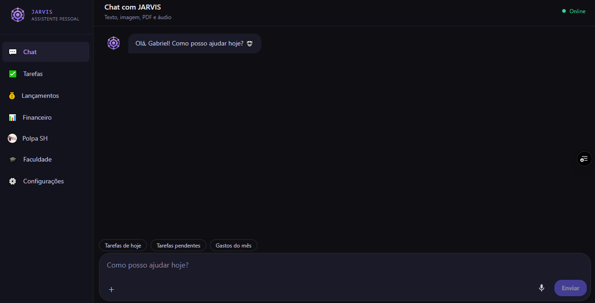
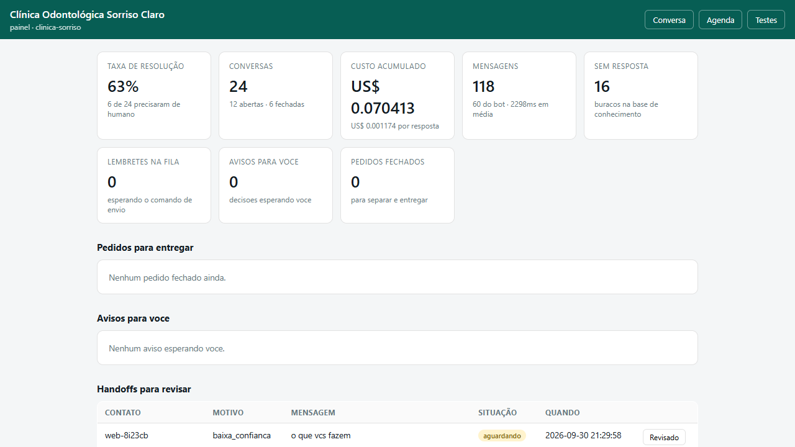
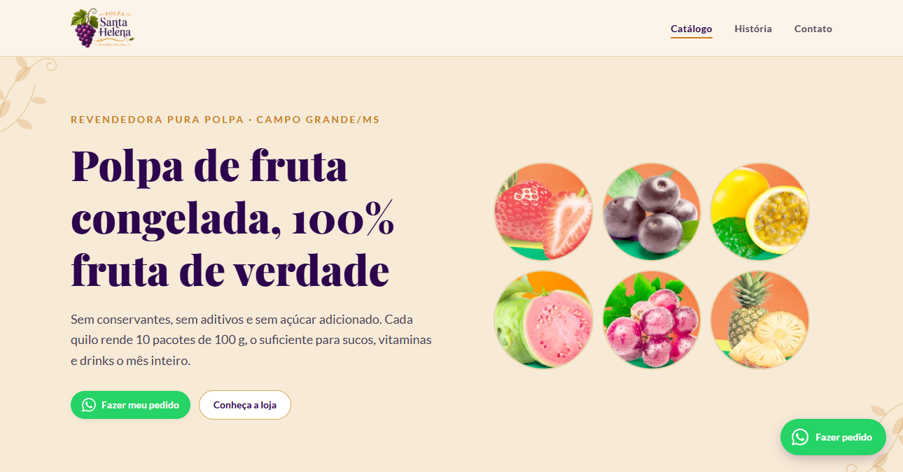
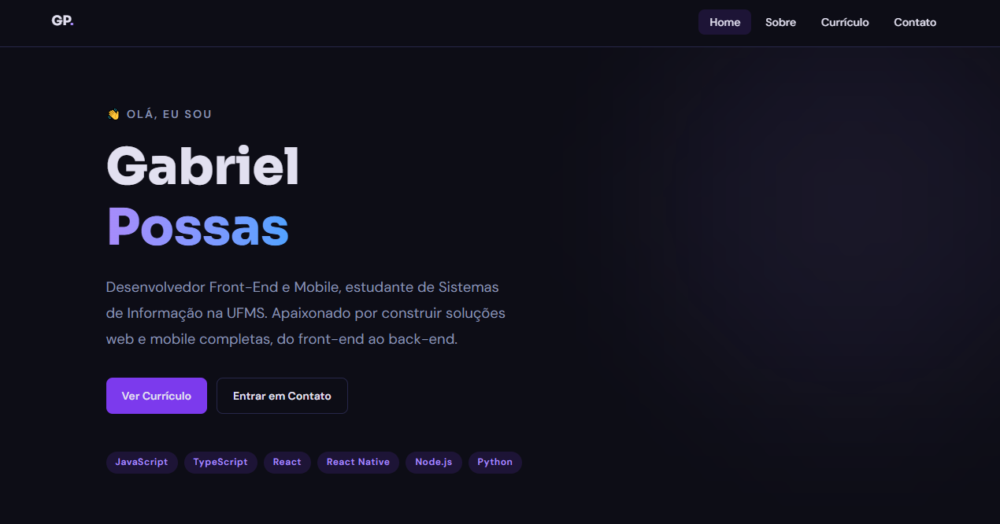

# Gabriel Possas

**Desenvolvedor Front-End & Mobile**, Campo Grande/MS

Construo aplicações web e mobile em React, React Native e TypeScript. Estudante de
Sistemas de Informação na UFMS, com formação técnica em Redes pelo SENAI.

Trabalhando com IA e agentes aplicados ao desenvolvimento, do assistente pessoal
ao atendimento automatizado. Aprofundando Python e arquitetura de agentes.

---

## Projetos

### [JARVIS](https://github.com/Gabrielpossasb/JARVIS)

Assistente pessoal com IA que recebe texto, áudio, imagem ou PDF e devolve dado
organizado, tarefas, lançamentos financeiros, estoque e rotina acadêmica.
Node.js, PostgreSQL.

---

### [Motor de Atendimento](https://github.com/Gabrielpossasb/MOTOR-ATENDIMENTO)

Atendimento automatizado por WhatsApp para comércio local, com painel de operação:
taxa de resolução, custo por resposta, lacunas na base de conhecimento e fila de
*handoff* para quando a conversa sai do script. Node.js com integração a modelo
de linguagem.

Medir custo por resposta e taxa de resolução foi uma decisão de projeto: sem isso
não dá para saber se o bot está ajudando ou só empurrando trabalho para o humano.

---

### [Compilador de Vídeo](https://github.com/Gabrielpossasb/COMPILADOR-VIDEO)

Transforma vídeo longo em resumo estruturado: busca a legenda, divide em blocos,
resume cada bloco com um modelo leve e consolida com um modelo mais forte,
estratégia que reduz custo de token sem perder o contexto do todo. Node.js.

---

### [Polpa Santa Helena](https://github.com/Gabrielpossasb/Polpa_Santa_Helena) · [ver no ar](https://polpasantahelena.com.br)

Catálogo online de uma distribuidora de polpas de fruta, com pedido direto pelo
WhatsApp. React, TypeScript, Tailwind, Vite.

---

### [Portfólio](https://github.com/Gabrielpossasb/Portfolio) · [ver no ar](https://portfolio-gabrielpossasb.vercel.app)

Projetos, trajetória e competências técnicas. React, TypeScript, Tailwind,
formulário de contato sem backend via EmailJS.

---

## Stack

---

## Contato

